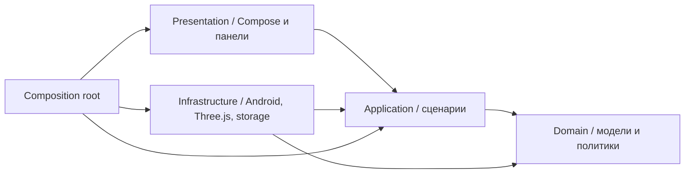
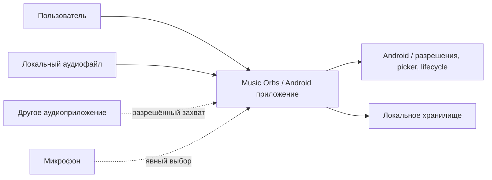
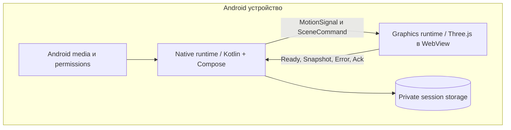
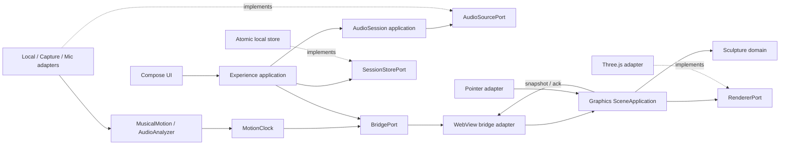
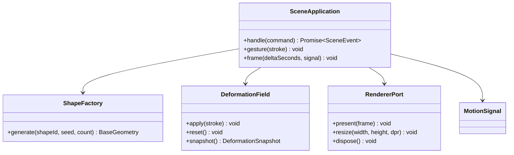
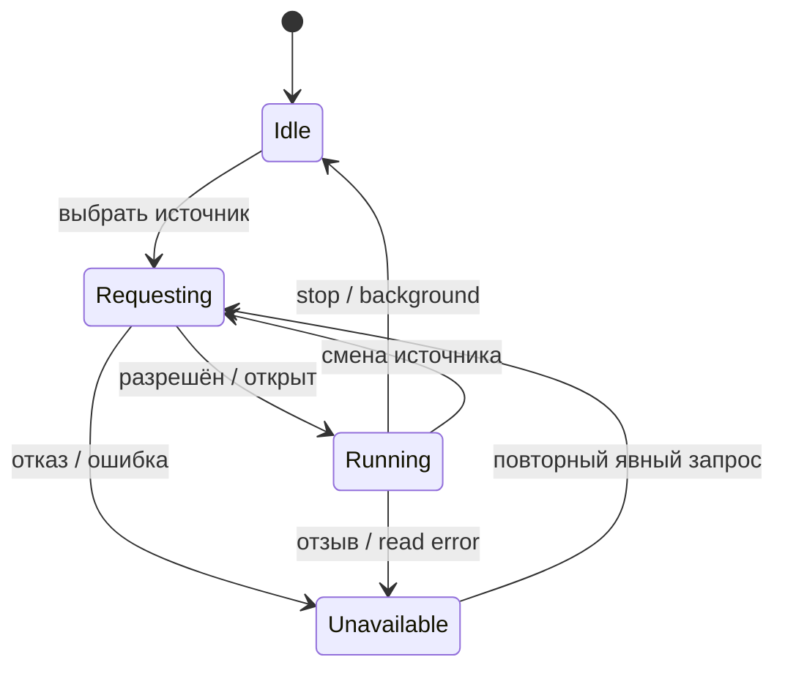

# Архитектура Music Orbs

Статус: проект архитектуры и каркас интерфейсов; рабочей реализации нет.
Требования: [scope.md](scope.md). Контракты: [spec.md](spec.md).

## 1. Контексты DDD и язык

| Bounded context | Модель и ответственность | Не отвечает за |
|---|---|---|
| Sculpture | Агрегат SculptedShape: ShapeId, базовая геометрия, поле DeformationField, ревизия. Инвариант: постоянные изменения в object space. | PCM, Android, системные разрешения |
| MusicalMotion | Агрегат MotionTimeline: оценка темпа, уверенность, энергия, медленный период и непрерывная фаза. | Геометрия, проигрывание, UI |
| AudioSession | Агрегат SourceSession: один активный источник, sourceSessionId, состояние разрешения/чтения. | Изменение формы и решения о визуальной эстетике |
| Experience | Агрегат ExperienceSession: активная форма, настройки и согласованный снимок деформаций. Сценарии UI и сохранение. | Алгоритм FFT, детали GPU |

Sculpture — основной домен продукта. MusicalMotion — поддерживающий домен.
AudioSession и Experience — поддерживающие контексты с платформенными адаптерами.
MaterialId не является ShapeId: способ рисования не определяет геометрию.
DDD-контексты — логические границы внутри одного приложения, не микросервисы.

## 2. Clean Architecture

В обоих runtime зависимости направлены внутрь:

Порты объявляются рядом с прикладными сценариями, которые их используют.
Домен содержит только типы и интерфейсы политик: без Android, Three.js, DOM,
файловой системы и JSON-парсинга. Адаптеры реализуют порты; composition root
создаёт зависимости. Ни application, ни domain не создают адаптеры сами.

Графический runtime владеет Sculpture и вычислением положения частиц.
Нативный runtime владеет AudioSession, MusicalMotion и постоянным хранением
Experience. Обмен — версионированные DTO, а не ссылки на внутренние агрегаты.
TypeScript-типы и Kotlin-типы транспорта должны проверяться общей схемой.
Фактические JSON Schema и генерация DTO относятся к последующей реализации.

## 3. C4: C1 — контекст

Сетевого backend нет. Внешнее приложение не интегрируется через внутренний API:
его разрешённое аудио получает платформенный AudioPlaybackCapture adapter.

## 4. C4: C2 — runtime-контейнеры

Это runtime-границы одного устанавливаемого приложения. Отдельных сервисов нет.
Browser harness подменяет нативный мост synthetic MotionSignal; Android использует
тот же локальный bundle с bridge adapter и нативным хранилищем.

## 5. C4: C3 — компоненты

Каждая стрелка показывает вызов или поток данных; implements показывает
реализацию порта, а не обратную зависимость домена от адаптера.

## 6. C4: C4 — кодовая модель Sculpture

Диаграмма обозначает проектные интерфейсы, а не готовые классы реализации.
Точное распределение внутренней математики по классам выбирается при разработке.

## 7. Геометрия и деформация

Порядок обработки: база → постоянное поле → временные волны/дыхание →
вращение объекта → проекция камеры. База детерминирована парой shapeId/seed
и версией генератора. Поле не привязано к индексам частиц: набор локальных
контрольных воздействий позволяет менять детализацию без потери скульптуры.

Pointer adapter переводит экранный жест через обратные model/view/projection
в локальные координаты. Предлагается фиксировать локальную плоскость контакта
на начало жеста и приостанавливать вращение на время активного указателя.
После отпускания вращение плавно продолжается. Прямое смещение по screen XY
без преобразования координат запрещено. Конкретная стратегия picking проверяется прототипом.

Количество контрольных воздействий ограничено политикой. При превышении лимита
нужны детерминированная компактизация или явный отказ; незаметная потеря формы недопустима.
Reset меняет ревизию и сохраняет пустое поле, чтобы старый снимок не воскресил деформацию.

## 8. Музыка и время

PCM → нормализация/окна → FFT, RMS, спектральные изменения → оценка BPM
и confidence → MotionClock → MotionSignal → Graphics.
Период при 4/4: `60 / bpm * 4 * bars`. Для 90 BPM и 8 тактов: 21,333… секунды.
Это инженерная оценка медленного периода, не обнаружение музыкальной фразы.

Clock использует монотонное время. Период меняется с ограничением скорости,
фаза интегрируется без сброса при новой оценке BPM. Старые сигналы и NaN отклоняются.
При тишине/неуверенности clock плавно стремится к автономному периоду.
Время GUI-кадра не является временем PCM. Анализ локального файла следует позиции
проигрывания; предварительный декодер не должен отправлять сигнал из будущего.

## 9. Смена источника и lifecycle

При смене сначала инвалидируется sourceSessionId и останавливается старый источник;
затем запрашивается новый. Графика в переходе автономна. Запоздалые callbacks
не применяются. В фоне сохраняется снимок, графика паузится, источники закрываются.
Возврат восстанавливает сцену, но не запускает скрытно микрофон или новый capture.
Audio focus loss и отключение гарнитуры обрабатываются как остановка/пауза локального источника.

## 10. Мост, хранение и отказоустойчивость

Мост принимает только доверенные локальные assets. Произвольная навигация,
file access и доступ к нативному объекту из удалённого контента не предусматриваются.
Конкретный transport выбирается при реализации; доменный API от него независим.
Каждое сообщение имеет protocolVersion, bridgeSessionId, sequence и тип.
Команды с requestId получают Ack/Error. Поток MotionSignal заменяет устаревший
сигнал последним, не создавая бесконечной очереди. На смене WebView handshake повторяется.

Хранилище нативное: versioned DTO, временный файл и атомарная замена.
Снимки имеют revision; старая асинхронная запись не заменяет новую.
Полное изменение сессии сохраняется как один согласованный снимок.
WebView не является владельцем постоянной копии. При crash до подтверждения
сохранения возможна потеря последних несохранённых движений.

## 11. Решения и технические проверки

| Решение | Причина | Что проверить до реализации зависимых функций |
|---|---|---|
| Three.js в локальном WebView | Один визуальный движок для Android и browser harness | WebGL, размеры point sprites, FPS и context loss на устройстве |
| Kotlin DSP | Независимость анализа от графики | Латентность, CPU и точность BPM на ambient/нерегулярном ритме |
| Общее локальное поле деформации | Одинаковая механика всех форм и уровней детализации | Picking, компактизация и визуальная стабильность |
| AudioPlaybackCapture как условный источник | Соответствует целевому Android-сценарию | Согласие, manifest/policy источника, отзыв и реальные приложения |
| Микрофон только по выбору | Предсказуемое поведение и отсутствие скрытой записи | Permission denial и индикатор |
| Нет обязательной сторонней DSP-библиотеки | Лицензирование ещё не исследовано для выбранной поставки | Лицензии перед включением любой зависимости |

Техническая справка: [Android playback capture](https://developer.android.com/media/platform/av-capture),
[Three.js BufferGeometry](https://threejs.org/docs/pages/BufferGeometry.html),
[Three.js Points](https://threejs.org/docs/pages/Points.html).
Версии SDK и зависимостей пока не выбраны; каркас не объявляет сборку готовой.

## 12. Переиспользование

Приоритет — адаптация проверенных библиотек, генераторов и shader-фрагментов.
Конкретные исходные файлы, commits, лицензии, целевые порты и ограничения
перечислены в [reuse.md](reuse.md). UpstreamShapeFactoryStub обозначает границу
адаптации геометрии, ThreeRendererStub — место reuse Three.js/GLSL,
PlaybackCaptureAdapter будет отделять заимствованный capture loop от домена.
Полные сторонние demo UI и recording-приложение в приложение не переносятся.

## 13. Фактический каркас

По последующему указанию пользователя созданы интерфейсы Kotlin/TypeScript,
модели данных и явные TODO/NOT_IMPLEMENTED-заглушки. Domain/application/adapters
разделены физически. После каркаса начата реализация: browser harness, DSP,
контракты и сборочные runners добавлены; результаты и ограничения — в [tests.md](tests.md).

## 14. Дальнейшая декомпозиция и контроль эстетики

Геометрия/материалы/деформация, DSP, нативные источники/UI/bridge и QA — четыре
независимые зоны разработки с заранее согласованными контрактами. Это разделение
ответственности, а не обязательство параллельного запуска агентов.
Browser harness использует тестовый MotionSignal без Android; аудиоанализ
проверяется на PCM независимо от графики. Человек выбирает визуальные варианты,
оценивает плавность, тестирует реальные касания и подтверждает системные разрешения.

MotionSignal даёт быстрый слой для малых акцентов свечения/плотности, средний
для волн и медленный для общего вращения/дыхания. Основное движение остаётся
медленным; распознавание настоящих фраз рассматривается только после MVP.
Сопротивление деформации — параметр пресета общего поля, не отдельный движок.
Плотность меняется через общий quality profile без изменения контрольных точек.
Процедурные формы, материалы и noise исполняются в GPU-адаптере при подтверждённой
поддержке; базовый путь остаётся простым. Нативный renderer — возможная замена
через RendererPort, если WebView не укладывается в измеренные бюджеты.
Unity/Godot не выбраны для текущего MVP; смена стека требует отдельного решения.

Палитры — наборы настроек цвета/свечения; текущий SceneSettings.colorHex описывает
один основной цвет. Перед реализацией многокрасочных палитр нужно дополнить
контракт paletteId/stops и fixtures. Это явный открытый пункт, а не обещание,
что заглушка уже реализует все варианты оформления.
Визуальные основания и изученные локальные видео: [references.md](references.md).

## 15. Уточнение по четырём видео

REF-01/03 требуют распределять частицы по складчатой поверхности с читаемыми
кромками и перекрывающимися прозрачными слоями. Одна полоса или равномерное
случайное облако не дают нужного образа Ribbon. Топология Мёбиуса не обязательна:
подходящий upstream-генератор проверяется по силуэту, затем закрывается ShapeFactory.
REF-04 задаёт округлую оболочку Orb с мягкими лопастями и перетяжками.
Отдельный Cloud остаётся проектным предложением без точного видеоэталона.

Для Pixel Cloud по REF-02 нужны пространственно упорядоченные квадратные
слои/рамки, просветы и насыщенный цвет. Это геометрия пресета, а не только
квадратная маска point sprite. Допускается детерминированная выборка слоёв
в BaseGeometry.positions; если понадобятся устойчивые координаты поверхности
или дополнительные атрибуты, их контракт согласуется до изменения фабрики.
Полный туннель, непрерывный пролёт камеры и монтажные смены сцен вне MVP.

Цвет относится к материалу/настройкам Experience. Один colorHex не описывает
многоцветный REF-02: до renderer/UI согласуются paletteId/stops, правило
распределения цвета и миграция прежних одноцветных снимков. Это план изменения
API, а не уже существующие поля. Обновляются spec.md, модели обоих runtime,
wire schema и fixtures одним пакетом. Палитра не меняет seed или деформацию.

GPU adapter отвечает за прозрачность/depth и ограничение свечения; alpha sorting,
overdraw и aliasing тонких пиксельных решёток проверяются на телефоне.
Из видео не выводятся коэффициенты DSP, частота BPM или физика жидкости.
Наше медленное движение и непрерывная фаза сохраняются, даже если REF-02
показывает более быстрые цветовые перестройки.

## 16. План реализации и OpenSpec

Планирование изменений ведётся через `openspec/`; [план](implementation-plan.md)
задаёт пакеты, владельцев файлов, зависимости и точки интеграции.
`docs/scope.md` остаётся источником FR/NFR, `docs/spec.md` — публичных контрактов;
OpenSpec фиксирует изменения к ним и задачи, не утверждая готовность заглушек.
Tooling OpenSpec установлен отдельно от будущего browser harness. Сгенерированные
skills не разрешают запуск агентов или реализацию без соответствующего указания.
