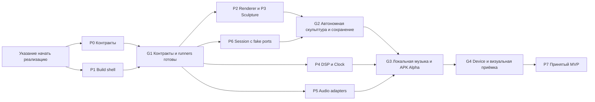

# План параллельной реализации

Дата: 2026-10-17. Статус: реализация запущена.
Интегратор ведёт контракты и общую интеграцию; параллельные потоки —
платформа/аудио, графика и музыкальный движок/сервисы сессии.
Завершённые пункты отмечаются в OpenSpec checklist после проверок.
Пакеты P0–P6 реализованы и проверены в согласованной матрице Android Emulator
API 35; G2/G3, нативные настройки, permissions и audio focus имеют отчёты.
P7 продолжается: внешний вид четырёх форм принят по статическим кадрам;
70-минутный профиль выполнен, бюджет app PSS прошёл, кадровые бюджеты нарушены.
Остаются дополнительные сквозные проверки и итоговая сверка приёмки.
Фактические результаты и ограничения — в [tests.md](tests.md)
и [матрице FT/CT](../tests/functional/results.md).

Основания: [scope](scope.md), [design](design.md), [контракты](spec.md),
[приёмка](tests.md), [изученные видео](references.md), [reuse](reuse.md).
Исполняемый список работ хранится в
[OpenSpec tasks](../openspec/changes/implement-mvp-blocks/tasks.md).

## 1. Пакеты и владение

Владелец — роль/поток работы, а не уже запущенный агент. Один файл в каждый момент
изменяет один владелец. Контексты остаются частями одного приложения.

| Пакет | Владелец и файлы | Результат | Зависимость и приёмка |
|---|---|---|---|
| P0 — общий контракт | Интегратор: `contracts/`, docs/spec.md, общие Models.ts/SessionModels.kt/MotionModels.kt/AudioModels.kt | ProfileLimits, wire v1, палитры, миграция снимков, golden fixtures и clock policy | После разрешения реализации; CT-03/04/06; блокирует зависимые функции |
| P1 — платформа | Android: корневые Gradle-файлы и Android build/manifest/bootstrap | Минимальный устанавливаемый Android 10+ shell, локальный WebView asset pipeline и команды сборки | Параллельно P0; готовность G1; FT-01 без аудио |
| P2 — графическая среда | Графика: graphics package/lock, `graphics/bootstrap/`, `graphics/sculpture/infrastructure/three/`, upstream adapters | Browser harness, процедурные Orb/Ribbon, затем Cloud/Pixel, материалы/палитры, quality и synthetic MotionSignal | Harness после P0; устройство после P1; FT-02/03/22/28/29, CT-01/08 |
| P3 — скульптура | Графика: `graphics/sculpture/domain/Policies.ts`, реализации поля, `application/`, `presentation/` | Поле в object space, picking/жесты, затухание, переключение, Reset и snapshot | Чистое поле после P0 параллельно renderer; жесты после P2; FT-04–07/10/25, CT-02 |
| P4 — музыкальное движение | DSP: `android/motion/`, свои PCM fixtures и тесты | Ограниченный анализ энергии/BPM/confidence, MotionClock и автономные переходы | После P0 и minimal JVM test runner из P1; не ждёт реальный capture; FT-14–17/23, CT-03 |
| P5 — аудиоисточники | Android: `android/audio/`, permission/focus/lifecycle adapters | Сначала локальный playback+PCM, затем capture и явный mic; матрица доступности | После P0/P1; spike capture не блокирует графику/DSP; FT-12/13/18–20/24/27, CT-07/08 |
| P6 — пользовательская сессия | Интегратор: `android/experience/`, `android/bootstrap/`; графический bootstrap подключает его bridge adapter по запросу | Bridge handshake, atomic store, Compose panel, restore/save, pause/resume | С fake ports после P0/P1; сквозная сборка после P2–P5; FT-08–11/21/23/26, CT-04/05/07 |
| P7 — интеграция и приёмка | Интегратор: `tests/contracts/`, `tests/functional/`, `tests/device/`, CI, docs | Работающий APK, сценарии, device matrix, измерения и визуальная оценка | Проверки добавляются вместе с реализацией каждого пакета; финал после P6; все FR/NFR |

Тесты узкого пакета пишет его владелец рядом с кодом; общие CT-04 fixtures
изменяет только P0/интегратор. `README.md`, docs/tree.md, third_party и общий
tasks.md обновляются интегратором по сведениям потоков, чтобы избежать конфликтов.
Добавляемый адаптер и тестовый файл получает владельца до начала работы.

## 2. Волны и точки интеграции



1. **Волна 0, G1:** P0 и P1 идут параллельно. Выбрать лицензионно допустимые
   зависимости, создать runners, зафиксировать wire/палитры/лимиты. Быстрый
   device spike capture проверяет риск внешнего источника; при запрете результат
   документируется, разработка продолжается с локальным файлом.
2. **Волна 1:** три основных потока: графика P2/P3, DSP P4, Android P5.
   P6 можно начать четвёртым потоком с fake bridge/store/source, если есть ресурс.
   При трёх исполнителях Android последовательно ведёт P5 и P6; это не меняет API.
   Внутри графики сначала Orb/Ribbon, затем Cloud и структурированный Pixel Cloud.
3. **Волна 2, G2:** Orb/Ribbon деформируются, продолжают автономное движение,
   переключаются без потери поля и восстанавливаются после перезапуска.
   Это первый обязательный сквозной срез; DSP/capture для него не нужны.
4. **Волна 3, G3:** локальный файл → фактически слышимая позиция PCM → DSP →
   MotionSignal → bridge → renderer. Выключение sync/пауза/смена трека сохраняют
   фазу и форму. APK собирается документированной командой, проходит smoke на устройстве.
5. **Волна 4, G4:** все четыре пресета, палитры, разрешения, capture/mic,
   lifecycle/context loss, performance и визуальная оценка по референсам.
   Недоступный условный источник отмечается в матрице; он не подменяется микрофоном.

Критический путь: P0/P1 → P2/P3 + P6 → локальный playback/DSP → G3 → device-приёмка.
Количество потоков и сроки согласуются при старте; прежние оценки scope §8
не складываются механически и не являются обещанием дат.

## 3. Что необходимо решить в P0

- Палитры: тип paletteId/stops, единицы/диапазоны, интерполяция и привязка цвета
  к стабильным координатам, fallback старого colorHex, версия/миграция snapshot.
- ProfileLimits: particle/control/payload/queue limits, deadline запросов,
  rate MotionSignal, значения quality и диапазоны настроек. Числа — предложение
  до прототипа, затем зафиксированное решение; не выдавать их за измерения.
- Привязка PCM timestamp к playback и шкалам runtime; обработка seek/gap,
  sourceSessionId без источника, sequence/bridgeSessionId, latest-value motion.
- Локальный pause/resume: текущий AudioSourcePort имеет только open/read/close,
  а AudioSession уже обещает pause/resume. Выбрать отдельный playback port или
  расширение адаптера и описать ответственность до реализации FR-11.
- Clock: BPM/confidence thresholds, ограничение изменения периода, resume delta,
  автономная скорость, 4/8/16 тактов. Допуски выбираются до проверки fixtures.
- Snapshot: generatorVersion, неизвестные версии, миграции, atomic revision и
  отсутствие зависимости поля/цвета от индекса частицы при смене count.

Контракты, Kotlin/TS, schema и fixtures входят в одно изменение. После G1 каждый
поток использует согласованные версии. Новая потребность сначала возвращается
интегратору как изменение контракта с перечнем затронутых потребителей.

## 4. Проверки и передача результата

Пакет передаёт: изменённые файлы, команду проверки и результат, сценарии FT/CT,
ошибки/ограничения и воспроизводимый артефакт. Заглушка не считается результатом.
Слияние пакета требует проверку направлений imports, локальных ссылок и diff --check.
Коммит/публикация выполняются только по указанию пользователя.

Визуальный G4: сравнить интервалы из references.md, записать параметры пресета,
quality, устройство, версию WebView и решение человека. Cloud оценивается отдельно
как предложенная эстетика. Метрики FPS/тепла/latency собираются на согласованной
матрице; планы FT/CT и typecheck их не заменяют.

## 5. OpenSpec harness

Установлен официальный CLI `@fission-ai/openspec` 1.14.3 (MIT), Node.js 24.20.0.
Инициализация: `openspec.cmd init --tools codex --language Russian --profile core`.
Созданы шесть skills в `.agents/skills/`, конфигурация — `openspec/config.yaml`.
Сгенерированные upstream skills сохранены как поставляются; проектные артефакты
пишутся по-русски, служебные заголовки и SHALL/MUST — по синтаксису OpenSpec.

В PowerShell из корня:

```powershell
openspec.cmd --version
openspec.cmd list
openspec.cmd status --change implement-mvp-blocks
openspec.cmd validate --all --strict --no-interactive
```

В агенте доступны `openspec-propose`, `openspec-explore`, `openspec-apply-change`,
`openspec-update-change`, `openspec-sync-specs`, `openspec-archive-change`.
Полный план — [change](../openspec/changes/implement-mvp-blocks/proposal.md).
Базовый `openspec/specs/` пока пуст: требования будущей реализации находятся
в delta specs change; их наличие не означает, что MVP уже реализован.
Обновление tooling: `npm.cmd install -g @fission-ai/openspec@<version>`, затем
`openspec.cmd update`; просмотреть diff skills и снова проверить план.
Проект не получает npm/Gradle runtime dependencies от установки CLI.

Официальные источники настройки:
[installation](https://github.com/Fission-AI/OpenSpec/blob/main/docs/installation.md),
[supported tools](https://github.com/Fission-AI/OpenSpec/blob/main/docs/supported-tools.md).
